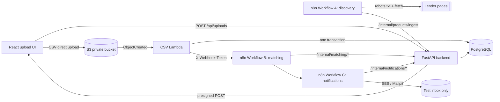

# Architecture

Source: [`architecture.mmd`](architecture.mmd) (Mermaid; GitHub renders the block below).

## Components

| Component | Local (docker compose) | AWS |
|---|---|---|
| Upload UI | `frontend` (Vite dev server, :5173) | any static host (S3 website/CloudFront/Netlify) pointing at the API URL |
| API | `api` (uvicorn, :8081) | `api` Lambda behind an HTTP API (Mangum) |
| Object storage | local volume + signed upload URL that mimics presigned POST | private S3 bucket, presigned POST |
| CSV processor | same `process_object()` called as a background task after upload | `processCsv` Lambda on `s3:ObjectCreated` |
| Database | `postgres:16-alpine` | RDS PostgreSQL 17, `db.t4g.micro`, private subnets |
| Workflows | `n8n` container (SQLite state in a volume) | n8n on a small EC2 instance in the same VPC (not created by `serverless.yml`) |
| Email | Mailpit (catches all mail, nothing leaves the machine) | AWS SES via n8n's SES node |

The business logic (`backend/app`) is identical in both modes. Only `STORAGE_MODE`, `NOTIFICATION_MODE` and connection settings change.

## Data flow

1. **Create batch.** The UI sends `{filename, size_bytes}` to `POST /api/uploads`. The API validates the extension and size, inserts an `upload_batches` row (`PENDING`), and returns a short-lived (5 min) upload target. In S3 mode this is a presigned **POST** policy that pins the key `uploads/<batch-uuid>/source.csv`, enforces `content-length-range` (≤ 10 MB) and requires SSE.
2. **Direct upload.** The browser posts the file straight to S3. The CSV never passes through API Gateway or Lambda request bodies.
3. **Event.** S3 emits `ObjectCreated`; the `processCsv` Lambda receives `(bucket, key)` and derives the batch id from the key. Keys that don't match the expected pattern are ignored.
4. **Claim.** An atomic `UPDATE ... WHERE status='PENDING' RETURNING` moves the batch to `PROCESSING`. A duplicate S3 delivery finds nothing to claim and exits. A crashed worker's claim expires after `PROCESSING_LEASE_SECONDS`.
5. **Validate + import.** The file is streamed and validated row by row (header, required fields, types, ranges, duplicate ids within the file). Valid rows are upserted in bounded multi-row statements (`INSERT_CHUNK_SIZE`). The batch's final status and counts are written **in the same transaction** as the rows, so a batch is never marked complete with only part of its rows committed.
6. **Trigger matching.** After commit, the processor POSTs `{upload_batch_id}` (no personal data) to the n8n Workflow B webhook with `X-Webhook-Token`. If the trigger fails, the import is kept and `matching_status=TRIGGER_FAILED` is recorded. It can be re-triggered via `POST /internal/batches/{id}/trigger-matching`.
7. **Workflow B** validates the batch and runs the optional criteria-normalization stage. It then calls the matching run, which does the SQL pre-filter, deterministic evaluation and persistence in 1,000-user chunks. Finally it triggers Workflow C.
8. **Workflow C** asks the backend for a grouped outbox (one message per user) and sends each message through SES or Mailpit (or skips sending in dry-run). It reports every outcome, then finalizes the batch's notification status.
9. **Workflow A** (independent; weekly + manual) refreshes `loan_products` from public lender pages.

## Why the CSV does not go through API Gateway / Lambda

* API Gateway has a 10 MB payload limit and Lambda's synchronous request limit is 6 MB. Binary/multipart handling also adds base64 overhead.
* The upload would hold an API Lambda for the whole transfer, which costs compute for every byte of network time.
* Presigned POST lets S3 enforce the size limit and key. It also scales without the backend, and the event-driven processor gets retries and isolation from the request path.

## State machines

`upload_batches.status`: `PENDING → PROCESSING → COMPLETED | COMPLETED_WITH_ERRORS | FAILED`. A transient error returns the batch to `PENDING` (so an S3/Lambda retry can reclaim it) until `MAX_PROCESSING_ATTEMPTS` (3), after which it becomes `FAILED`.

`matching_status`: `NOT_STARTED → TRIGGERED | TRIGGER_FAILED → RUNNING → COMPLETED | FAILED`.

`notification_status`: `NOT_STARTED → IN_PROGRESS → COMPLETED | COMPLETED_WITH_ERRORS`.

## Database design

Migrations: [`backend/migrations/001_initial_schema.sql`](../backend/migrations/001_initial_schema.sql) and [`002_notification_superseded.sql`](../backend/migrations/002_notification_superseded.sql), applied by `python -m app.migrate` (tracked in `schema_migrations`, guarded by an advisory lock).

| Table | Purpose | Key constraints / indexes |
|---|---|---|
| `upload_batches` | One row per upload. Holds status, row counts, capped `row_errors` (row/field/code only, no cell values), and matching/notification status | PK uuid, `storage_key` unique, index `(status, created_at)` |
| `users` | Imported profiles; `upload_batch_id` = the batch that created or last updated the row | `user_id` unique, CHECK ranges, index `(upload_batch_id, id)` for keyset paging, `(upload_batch_id, credit_score, monthly_income)` |
| `loan_products` | Products with criteria. **NULL criterion = unknown.** Keeps `data_origin` (`crawled` / `dev_fixture` / `manual`), source URL + attribution, `last_verified_at`, crawl-failure counter, `is_stale`, `is_active` | unique `(lender_name, product_name)`, CHECKs on rate/score/age ranges, partial index on active rows |
| `matching_runs` | One row per matching run, holding the optimization counters | index `(upload_batch_id, started_at)` |
| `matches` | Pairs that passed every known criterion: `ELIGIBLE` / `POTENTIAL`, `criteria_coverage`, `passed_criteria` and `unknown_criteria` explanations | unique `(user_id, loan_product_id, upload_batch_id)` |
| `notification_logs` | One row per user per match set: test recipient used, masked original address, mode, status (`PENDING`/`SENT`/`DRY_RUN`/`FAILED`/`GAVE_UP`/`SUPERSEDED`), provider message id, attempts, last error | unique `idempotency_key` = sha256(batch, user, sorted product ids); migration `002` adds `SUPERSEDED` |

`criteria_coverage` has a defined meaning: the fraction of the five standard criteria (min income, min score, min age, max age, employment types) that the lender actually published and we extracted. It is **not** an approval probability.

Re-uploading a user moves that user to the new batch (`users.upload_batch_id`). Matching only reads users whose current batch is the one being matched (batch isolation). A user who was later re-uploaded is matched with the newer batch.

## Networking on AWS (summary; details in AWS_DEPLOYMENT.md)

* Lambdas run in the VPC's subnets with an egress-only security group. RDS accepts 5432 only from that group and is not publicly accessible.
* There is **no NAT gateway** (≈ US$32+/month). S3 is reached through a free **gateway VPC endpoint**. Lambda reaches n8n on its **private IP** (n8n's EC2 instance is in the same VPC, and its SG allows 5678 from the Lambda SG). n8n reaches the API over the public HTTP API URL using `X-Internal-Token`.
* Secrets: the DB password and tokens live in SSM Parameter Store (SecureString). They are resolved at deploy time into Lambda environment variables, which Lambda encrypts at rest with KMS. Runtime fetching from Secrets Manager is supported (`DB_SECRET_ARN`), but it needs an interface endpoint (~US$7/month per AZ) or NAT inside a VPC, so it is not the default.
* Connections: each Lambda container reuses one connection across warm invocations, and `processCsv` has no reserved concurrency (the dev account's Lambda limit is 5, so all functions share those 5). With `db.t4g.micro` (~80 max connections) that is enough for this workload. **RDS Proxy** (billed per vCPU of the DB, roughly US$20+/month at minimum) is worth adding only if API concurrency grows into connection exhaustion; it is documented, not deployed.
